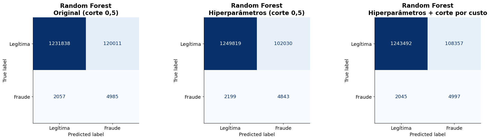

# MLOps: Credit Card Fraud Detection


The **production side** of a credit card fraud detection project: an automated training pipeline (**Airflow**), experiment
tracking and a model registry (**MLflow**), containers (**Docker Compose**) and a **Streamlit** app that scores transactions
with the champion model.

> The exploratory analysis, the comparison of 10 algorithms and the model insights live in the companion repository
> **[Credit-Card-Fraud-Detection-on-34.6M-Transactions](https://github.com/RafaelGallo/Credit-Card-Fraud-Detection-on-34.6M-Transactions)**.
> This repository turns that work into a repeatable pipeline and a deployable app.
>
> **The dataset is synthetic.** The numbers here are not real-world estimates.

## Table of contents

1. [Architecture](#1-architecture)
2. [Model at a glance](#2-model-at-a-glance)
3. [Airflow pipeline](#3-airflow-pipeline)
4. [MLflow: tracking, registry and promotion](#4-mlflow-tracking-registry-and-promotion)
5. [Streamlit app](#5-streamlit-app)
6. [Deploy the app on Streamlit Community Cloud](#6-deploy-the-app-on-streamlit-community-cloud)
7. [Run everything with Docker](#7-run-everything-with-docker)
8. [Run only the app or the pipeline steps](#8-run-only-the-app-or-the-pipeline-steps)
9. [Configuration](#9-configuration)
10. [Project structure](#10-project-structure)
11. [Project status and limitations](#11-project-status-and-limitations)
12. [Documentation and license](#12-documentation-and-license)

---

## 1. Architecture

```
 input/credit_card_fraud.csv  (~10 GB, mounted read-only, never committed)
        │
        ▼
 Airflow DAG  fraude_cartao_pipeline
 validate_base → convert_parquet → prepare_sample → split_data → train_evaluate → promote
                                                                      │                │
                                                       metrics, params, model          │ new champion?
                                                                      ▼                ▼
                                                      MLflow server (Postgres +   mlflow/producao/modelo_final.joblib
                                                      artifacts), model registry              │
                                                      alias "champion"                        ▼
                                                                                      Streamlit app
                                                                          (falls back to models/modelo_final.joblib)
```

| Component | Role | Port |
|---|---|---|
| **Airflow** (`LocalExecutor`) | Runs the training pipeline on demand | 8080 |
| **MLflow** | Tracks runs, stores artifacts, hosts the model registry | 5000 |
| **PostgreSQL** | Metadata for Airflow and MLflow (two databases) | internal |
| **Streamlit app** | Scores single transactions and CSV batches, shows risk maps | 8501 |

Design choices:

- The pipeline is **plain Python** (`src/pipeline_treino.py`). The DAG only orchestrates, so the same code runs in Airflow, a terminal or a test.
- Steps exchange **files, not XCom payloads**, because the dataset has tens of millions of rows.
- Training **never overwrites** the model in the repository. The DAG publishes the champion to `mlflow/producao/`, and the app prefers that
  file, falling back to `models/modelo_final.joblib`.
- **One scikit-learn version everywhere** (`1.5.2`): the model is a pickle and only loads safely on the series that produced it.

## 2. Model at a glance

**Random Forest** (200 trees, depth 6) with a cost-based decision threshold of **0.395**. Test set: 1,358,891 transactions
(Aug 14 to Dec 23, 2020), 7,042 frauds (0.52%). Cost = value of missed frauds + US$ 10 per false alarm (an assumption).

| Scenario on the test set | Frauds caught | Missed | False alarms | Cost (US$) |
|---|---:|---:|---:|---:|
| No model | 0 | 7,042 | 0 | 3,810,073 |
| Original Random Forest, 0.5 cutoff | 4,985 | 2,057 | 120,011 | 1,446,207 |
| Tuned, 0.5 cutoff | 4,843 | 2,199 | 102,030 | 1,290,984 |
| **Tuned, cost-based cutoff (0.395)** | **4,997** | **2,045** | **108,357** | **1,298,802** |

About **71%** of the frauds are caught with ~4% precision (around 22 false alarms per fraud), and the cost drops by ~66% against having no model.
Test PR-AUC is **0.2835**, against 0.1526 for using the purchase amount alone as the score.




(Chart labels inside the images are in Portuguese. More figures, the full comparison and the EDA insights are in the
[companion repository](https://github.com/RafaelGallo/Credit-Card-Fraud-Detection-on-34.6M-Transactions).)

## 3. Airflow pipeline

DAG `fraude_cartao_pipeline` ([`airflow/dags/fraude_pipeline.py`](airflow/dags/fraude_pipeline.py)), triggered manually
(`schedule=None`) because a full run uses the ~10 GB dataset. The logic of each step is in [`src/pipeline_treino.py`](src/pipeline_treino.py).

| Task | What it does |
|---|---|
| `validar_base` | Checks that `credit_card_fraud.csv` exists and has the columns the pipeline uses |
| `converter_parquet` | CSV to Parquet with only the model columns (no personal data). Skipped when the Parquet is newer than the CSV |
| `preparar_amostra` | Keeps 1 in N transactions (hash, preserves the fraud rate) before Dec 24, 2020, sorted by time |
| `dividir_dados` | Time split: test = last 20%, validation = last 20% of the rest, 1:10 undersampling on the fit part only, fits the encoder |
| `treinar_avaliar` | Random search for the Random Forest (score = validation PR-AUC), cost-based threshold, test evaluation, logs everything to MLflow |
| `promover` | Registers a model version and, if it beats the champion, promotes it and publishes the bundle for the app |

Trigger parameters:

| Parameter | Default | Effect |
|---|---|---|
| `n_iter` | 8 | Combinations tried in the random search |
| `fp_custo` | 10.0 | Cost (US$) of reviewing a false alarm; used for the threshold and the test cost |
| `amostra_um_em` | 5 | Uses 1 of every N transactions (5 = 20% of the data) |
| `so_se_melhor` | true | Promote only when the test cost is lower than the champion's |
| `refazer_parquet` | false | Reconvert the CSV even if the Parquet is up to date |

## 4. MLflow: tracking, registry and promotion

Experiment `fraude-cartao`. Each DAG run creates a parent run with one nested run per random-search combination.

- **Parameters:** search size, false-alarm cost, seed, fit/validation/test row counts, and the best hyperparameters.
- **Metrics:** validation PR-AUC and cost, the threshold, and on the test set PR-AUC, ROC-AUC, PR-AUC of the amount alone, frauds caught/missed,
  false alarms, precision, recall, total cost, cost with no model and the cost reduction.
- **Artifacts:** the scikit-learn model (`model/`) and a bundle (`pacote/modelo_final.joblib`) with model + threshold + encoder, the exact format the app loads.
- **Registry:** model `fraude_cartao_random_forest`. Each run creates a new version tagged `promovido=true|false`. The alias **`champion`** marks the
  version in production and moves only in the `promover` task.

**Promotion rule.** A new version becomes champion when there is no champion yet, or `so_se_melhor` is off, or its **test cost is lower** than the current
champion's. Only compare runs that use the same sample size and false-alarm cost, since they share the same test set. When promoted, the bundle is copied
atomically to `mlflow/producao/modelo_final.joblib`, and the app reloads it when the file changes.

```python
import mlflow
mlflow.set_tracking_uri("http://localhost:5000")
runs = mlflow.search_runs(experiment_names=["fraude-cartao"], order_by=["metrics.teste_custo_total_us ASC"])
champion = mlflow.sklearn.load_model("models:/fraude_cartao_random_forest@champion")
```

> Models are stored with `cloudpickle` (MLflow's default `skops` format rejects the Random Forest trees as untrusted types). Pickles run code when loaded,
> so only load models from your own MLflow server.

## 5. Streamlit app

Main file: [`app/streamlit_app.py`](app/streamlit_app.py) (the interface is in Portuguese).

| Tab | What it does |
|---|---|
| **Single transaction** | Fill in the 9 fields and see the risk score, the decision (alert or release), the threshold gauge and how the amount changes the score |
| **Batch analysis (CSV)** | Upload a CSV (up to 300,000 rows, 50 MB) and see alerts, review cost, the **map by customer location**, the score distribution and the highest-risk transactions. With an `is_fraud` column it also reports recall, precision and cost |
| **About the model** | Problem, method, test results and limitations |

- **Map:** *Risk score (0 to 1)* works with any CSV; *Result: fraud x false alarm* needs `is_fraud` (orange = fraud caught, gray = false alarm).
- **Model source:** the app loads `FRAUDE_MODELO_PATH` if the file exists (Docker: the champion published by the DAG), otherwise `models/modelo_final.joblib`.
- **Local dataset button:** if `input/credit_card_fraud.csv` exists, the app can draw N transactions from it (only the model columns and `is_fraud` are read).
- The score is **not a calibrated probability**: training used undersampling. It ranks risk.

## 6. Deploy the app on Streamlit Community Cloud

Community Cloud runs **only the Streamlit app**. Airflow and MLflow need Docker (section 7). The app deploys with the model committed in `models/`.

1. Push this repository to GitHub. The `.gitignore` already blocks the ~10 GB dataset and the heavy models; only `models/modelo_final.joblib` (1.6 MB) is tracked.
2. On [share.streamlit.io](https://share.streamlit.io), sign in with GitHub and click **Create app**.
3. Pick this repository, the `main` branch and the main file path **`app/streamlit_app.py`**.
4. Under **Advanced settings**, select **Python 3.12** (`scikit-learn==1.5.2` is pinned in the root `requirements.txt`). The Python version can only be changed by recreating the app.
5. Click **Deploy**. Every `git push` to the branch redeploys the app.

To ship a newer champion to the cloud app, copy `mlflow/producao/modelo_final.joblib` over `models/modelo_final.joblib`, commit and push.

## 7. Run everything with Docker

Requires Docker Desktop (or Docker Engine with Compose v2) running, ~8 GB of free RAM for Docker, and the dataset at `input/credit_card_fraud.csv`.

```bash
cd docker
cp .env.example .env     # set the passwords and AIRFLOW_FERNET_KEY (see below)
docker compose up --build
```

Generate the Fernet key with `python -c "from cryptography.fernet import Fernet; print(Fernet.generate_key().decode())"`.

| Service | URL | Login |
|---|---|---|
| Airflow | http://localhost:8080 | `AIRFLOW_USER` / `AIRFLOW_PASSWORD` from `.env` |
| MLflow | http://localhost:5000 | none (local only) |
| Streamlit app | http://localhost:8501 | none |

Then open the DAG `fraude_cartao_pipeline` in Airflow, click **Trigger DAG w/ config**, adjust the parameters and watch the runs in MLflow. For a quick test,
point `DADOS_DIR` in `.env` to a folder with a smaller `credit_card_fraud.csv`.

Useful commands: `docker compose ps`, `docker compose logs -f mlflow`, `docker compose down` (keeps data) and `docker compose down -v` (**deletes** databases and artifacts).

## 8. Run only the app or the pipeline steps

**Only the app**

```bash
python -m venv .venv
.venv\Scripts\activate            # Linux/macOS: source .venv/bin/activate
pip install -r requirements.txt
streamlit run app/streamlit_app.py
```

**Pipeline steps without Airflow** (needs `polars`, `pyarrow` and `mlflow`, see `docker/requirements-airflow.txt`)

```python
import sys; sys.path.insert(0, "src")
from pathlib import Path
import pipeline_treino as pt

csv, pq, work = Path("input/credit_card_fraud.csv"), Path("work/full.parquet"), Path("work/execucao")
pt.validar_base(csv)
pt.converter_parquet(csv, pq)
pt.preparar_amostra(pq, work)
pt.dividir_dados(work)
result = pt.treinar_avaliar(work, "sqlite:///work/mlflow.db")
pt.promover(result, "sqlite:///work/mlflow.db", Path("mlflow/producao"))
```

## 9. Configuration

`docker/.env` (copy from `docker/.env.example`; it is git-ignored):

| Variable | Meaning |
|---|---|
| `DADOS_DIR` | Folder with `credit_card_fraud.csv`, mounted read-only into Airflow (default `../input`) |
| `POSTGRES_PASSWORD` | Password of the Postgres user shared by Airflow and MLflow |
| `AIRFLOW_USER`, `AIRFLOW_PASSWORD` | Airflow web login |
| `AIRFLOW_UID` | On Linux/macOS use `id -u`; on Windows/Docker Desktop leave 50000 |
| `AIRFLOW_FERNET_KEY`, `AIRFLOW_SECRET_KEY` | Airflow secrets (required) |

The example values are for **local use only**. Do not expose ports 5000 or 8080 to the internet: the local MLflow has no authentication.

## 10. Project structure

```
.
├── app/streamlit_app.py            # Streamlit interface (3 tabs)
├── src/
│   ├── modelo.py                   # model loading, batch validation, prediction, metrics
│   ├── mapa.py                     # bubble maps by customer location
│   └── pipeline_treino.py          # training pipeline steps used by the DAG
├── airflow/dags/fraude_pipeline.py # Airflow DAG
├── docker/                         # docker-compose, Airflow and app images, .env.example
├── mlflow/                         # MLflow server image; producao/ holds the published champion
├── models/modelo_final.joblib      # model bundle used by the app (other model files stay local)
├── output/transacoes_novas.csv     # 5,000 sample transactions for the app
├── notebook/                       # EDA and modeling notebooks
├── img/                            # figures used in this README
├── doc/                            # detailed documentation (Portuguese)
├── .streamlit/config.toml          # theme and upload limit
└── requirements.txt                # dependencies of the Streamlit app
```

## 11. Project status and limitations

**What was validated**

- The pipeline steps ran end to end on a 400,000-row sample of the dataset with an SQLite-backed MLflow: Parquet conversion (and its reuse), sampling, split,
  random search, threshold, test metrics, model registration, and the promotion rule (first model promoted, a tie not promoted, a forced promotion promoted).
- The champion loaded through MLflow (`models:/fraude_cartao_random_forest@champion`) and the published bundle loaded in the app through `FRAUDE_MODELO_PATH`.
- The app runs from this repository on the pinned requirements.

**What was not run yet**

- **The Docker Compose stack has not been brought up end to end.** `docker compose config` validates, but the images, the Airflow DAG import inside the
  container and the MLflow `--allowed-hosts` setting still need a first real run. Expect to adjust something on the first `docker compose up --build`.
- The full pipeline on the complete 10 GB dataset was not executed through Airflow.

**Limitations**

- Synthetic data; patterns are sharper than in real life.
- One data split, a fixed seed and a search of only 8 combinations: retrained models vary (an earlier version had 31,314 false alarms against 108,357 for the current one).
- US$ 10 per false alarm is an assumption, and the threshold and savings depend on it.
- The text in the app's "About the model" tab is fixed in the code and matches the model in `models/`. If you promote a different champion, update it.

## 12. Documentation and license

Detailed documentation (Portuguese) is in [`doc/`](doc/README.md): [Docker guide](doc/guia-docker.md), [Airflow pipeline](doc/pipeline-airflow.md),
[MLflow](doc/mlflow.md), [Streamlit app](doc/app-streamlit.md) and [model and data](doc/modelo-e-dados.md).

Licensed under the [MIT License](LICENSE). Author: Rafael Gallo.
